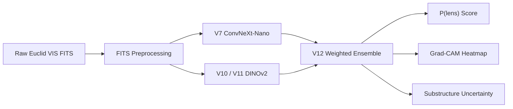

<div align="center">


<sub><i>Strong gravitational lensing — Einstein ring observed by the Hubble Space Telescope. Credit: NASA/ESA</i></sub>

</div>

<br />

<div align="center">

# Gravitational Lens Detection on ESA Euclid Q1 Data

<p>
  <a href="https://doi.org/10.5281/zenodo.20037150">
    
  </a>
  &nbsp;
  <a href="https://doi.org/10.5281/zenodo.20056736">
    
  </a>
  &nbsp;
  <a href="LICENSE">
    
  </a>
  &nbsp;
  <a href="https://gravitational-lensing.vercel.app">
    
  </a>
</p>

A deep learning pipeline for automated gravitational lens detection and dark matter substructure analysis, trained and validated on real observational FITS cutouts from the ESA Euclid Q1 release.

[Website](https://gravitational-lensing.vercel.app) · [Scan Results (Zenodo)](https://doi.org/10.5281/zenodo.20037150) · [Dataset & Weights (Zenodo)](https://doi.org/10.5281/zenodo.20056736) · [ESA SLDE Catalog](https://zenodo.org/records/15025832)

</div>

---

## Overview

Strong gravitational lensing — the bending of light from distant galaxies by foreground mass — is one of the most powerful probes of cosmological structure. Identifying lenses at scale in modern surveys is a computer vision problem: millions of galaxies must be screened for the subtle arc-like distortions that signal a lensing event.

This project builds and benchmarks a complete detection pipeline on the first public data release (Q1) of the ESA Euclid mission. All models are trained and evaluated on **real observational FITS cutouts** from the Euclid VIS instrument, not simulations.

Two research tracks are addressed:

- **Track A — Binary Lens Detection:** Does this galaxy image contain a strong lensing event? Culminates in a weighted ensemble achieving AUROC = **0.8871**.
- **Track B — Substructure Classification:** Given a confirmed lens, is the dark matter distribution smooth, CDM-subhalo-dominated, or axion-like? Concluded after 7 methods — the signal lies below the detection threshold of Q1 PSF quality, a finding consistent with the ESA Euclid Consortium's own assessment.

The standardized evaluation split is published in the Zenodo data release and was never modified across any experiment.

---

## Results

### Track A — Binary Lens Detection

All models are evaluated on the same held-out test set: **50 Grade A positives + 150 Grade C negatives** (200 total). Test-Time Augmentation (TTA) applies 4 × 90° rotations and averages the resulting probabilities.

| Version | Backbone | Pretraining | AUROC (TTA) | Precision | Recall | F1 | Threshold |
| :--- | :--- | :--- | :---: | :---: | :---: | :---: | :---: |
| V6 | EfficientNet-B0 | Simulation (DeepLense) | 0.7283 | 0.579 | 0.440 | 0.500 | 0.583 |
| V7 | Zoobot ConvNeXt-Nano | Real Galaxy Morphology | 0.8541 | 0.704 | 0.760 | 0.731 | 0.623 |
| V8 | Zoobot ConvNeXt-Small | Real Galaxy Morphology | 0.8499 | 0.4096 | 0.6800 | 0.5113 | 0.2700 |
| V9 | Zoobot ConvNeXt-Nano + Hard Negatives | Real Galaxy Morphology | 0.8587 | 0.546 | 0.720 | 0.621 | 0.480 |
| V10 | DINOv2-Small (ViT-S/14) | Self-Supervised (LVD-142M) | 0.8756 | 0.576 | 0.760 | 0.655 | 0.230 |
| V11 | DINOv2-Base (ViT-B/14) | Self-Supervised (LVD-142M) | 0.8776 | 0.556 | 0.800 | 0.656 | 0.300 |
| **V12 (Best)** | **Ensemble (V7 + V10 + V11)** | **Galaxy Prior + LVD-142M** | **0.8871** | **0.8333** | **0.7000** | **0.7609** | **0.7000** |
| V15 | DINOv2-Base + pseudo-labeled positives | Self-Supervised (LVD-142M) | 0.8687 | — | — | — | — |

<sub>V12 is the primary research outcome, achieving the highest AUROC and F1 on the held-out test set. V7 is the production model deployed in the web application: its 14.9M parameters and single-channel input make it suitable for browser-native ONNX inference, and its threshold of 0.623 gives a calibrated operating point (precision 0.704). V2–V5 are excluded from primary results (V2, V4, and V5 were invalidated by data leakage; V3 failed to converge due to label noise). V6 is the first validated result. V13 and V14 are data-mining steps, not independently evaluated models. V16 failed its gate at AUROC 0.8421.</sub>

**Key findings:**

- Switching from a simulation-pretrained EfficientNet (V6, AUROC 0.7283) to a galaxy-morphology-pretrained Zoobot encoder (V7, AUROC 0.8541) yielded **+0.1258 AUROC** — the largest single gain in the project.
- Adding 234 pseudo-labeled positives (V15, 394 total, +146% training data) scored AUROC 0.8687 — lower than V11 on 160 clean labels. V16 (285 hard negatives) dropped AUROC by 0.0355. Both results confirm label quality outweighs data quantity at this scale.
- The ensemble gain of V12 over V11 is +0.0095 AUROC. With 50 test positives, differences below roughly 0.02 may not be statistically meaningful (standard error ≈ 0.032); no confidence intervals have been computed.

---

### Track B — Dark Matter Substructure Classification

All 7 methods evaluated on 205 real Euclid lens FITS images. Lower entropy = more confident predictions. Maximum possible entropy = log₂(3) = **1.585 bits**. High-confidence threshold: entropy < 0.5 bits.

| Method | Approach | Mean Entropy (bits) | Uncertain % | High-Confidence | Criteria Passed |
| :--- | :--- | :---: | :---: | :---: | :---: |
| 1. Baseline MC Dropout | Original model, no adaptation | 1.1236 | 94.6% | 11 / 205 | 0 / 4 |
| 2. CORAL | Covariance alignment, 50 epochs | 0.1429 | 100% | 0 / 205 | 1 / 4 — CDM collapse |
| 3. DANN | Adversarial domain adaptation, lambda=0.5 | 1.5807 | 100% | 0 / 205 | 0 / 4 — random |
| 4. ADDA | Adversarial discriminative, 50 epochs | 1.5732 | 100% | 0 / 205 | 0 / 4 — axion collapse |
| **5. Noise Injection** | **Add Euclid noise (sigma≈0.03) to simulation training** | **0.7524** | **71.2%** | **59 / 205** | **4 / 4 — BEST** |
| 6. PSF + Noise + TTA | PSF blur + progressive noise + test-time augmentation | 1.0759 | 88.8% | 23 / 205 | 1 / 4 |
| 7. Deep Ensemble (3 seeds) | 3 × Method 5, majority vote | 0.9626 | 90.2% | 20 / 205 | 1 / 4 |

**Scientific conclusion:** All three domain adaptation methods (CORAL, DANN, ADDA) collapsed due to a 30,000:205 simulation-to-real class imbalance. Noise injection reduced entropy by 33% and increased high-confidence predictions 5× over baseline without collapse. Under current Q1 VIS resolution (PSF FWHM ≈ 0.16″–0.18″), the substructure signal lies below the detection limit for domain adaptation models. Track B is scientifically complete; no further work is planned.

---

### Unseen Q1 Population Scan

After training concluded, the V12 ensemble was applied to all 1,415 Euclid Q1 candidate files outside the standardized evaluation split (zero overlap with train/val/test — verified by skycoord crossmatch < 2 arcsec). Threshold: 0.70. TTA enabled.

| Population | Files Scanned | Flagged at t=0.70 | Flag Rate |
| :--- | :---: | :---: | :---: |
| Grade B (all) | 247 | 99 | 40.1% |
| Grade B — positive declination | 86 | **33** | **38.4%** |
| Grade B — negative declination (NEG prefix) | 161 | 66 | 41.0% |
| Grade C holdout | 1,168 | 526 | 45.0% |
| All-model agreement at P > 0.90 | — | 228 | — |

The 38.4% flag rate among positive-declination Grade B candidates reflects conservative candidate selection at threshold 0.70 (where model recall is ~70%). The "NEG" filename prefix in the ESA SLDE catalog denotes negative declination coordinates, not negative ground-truth labels. The high Grade C rate reflects out-of-distribution false alarms on morphologies not represented in the training negatives. Full results (1,415 rows with per-model scores) and a 32-page visual discovery gallery are published on Zenodo.

---

## Pipeline

The diagram below shows the inference path for a single Euclid VIS FITS cutout through the V12 ensemble. Training code, checkpoints, and the evaluation split are archived on Zenodo.



| Stage | Detail |
| :--- | :--- |
| **Preprocessing** | Centre-crop 300×300 → 10 px border-ring background subtraction → log1p stretch → percentile [1, 99] normalisation → bilinear resize 224×224 |
| **V7** | ConvNeXt-Nano, Zoobot greyscale prior (`mwalmsley/zoobot-encoder-greyscale-convnext_nano`); 1-channel input, no ImageNet normalisation; feature size 640 |
| **V10 / V11** | DINOv2 ViT-S/14 and ViT-B/14, self-supervised on LVD-142M; 3-channel input with ImageNet normalisation; feature sizes 384 / 768 |
| **V12 Ensemble** | Weighted logit averaging (V7 × 0.3, V10 × 0.2, V11 × 0.5) with 4 × 90° rotation TTA |

**Training protocol:** All models use two-stage fine-tuning. Stage 1 trains the classification head only (5 epochs, LR = 1e-3) with the encoder frozen. Stage 2 unlocks the full model with a warmup encoder learning rate (1e-7 → 5e-6) and a fixed head LR of 5e-5, for up to 20 epochs with the best validation AUROC checkpoint saved.

---

## Reproducibility

### FITS Preprocessing

The pipeline below is deterministic and the exact order of operations must be preserved. V7 takes 1-channel input with no ImageNet normalisation. V10/V11 replicate the single channel to 3 channels and apply ImageNet normalisation.

```python
from astropy.io import fits
import numpy as np
import cv2

def preprocess_fits(path, target_size=224):
    """
    Deterministic Euclid VIS preprocessing pipeline.
    Output for V7: float32 tensor shape (1, 224, 224), range [0, 1].
    """
    with fits.open(path) as hdul:
        data = next(h.data for h in hdul if h.data is not None and h.data.ndim >= 2)
    data = np.squeeze(data).astype(np.float32)

    # Check NaN fraction
    if np.isnan(data).sum() / data.size > 0.3:
        raise ValueError("Over 30% NaN pixels. File may be corrupted.")
    data = np.nan_to_num(data, nan=0.0, posinf=0.0, neginf=0.0)

    # 1. Centre-crop to 300x300
    h, w = data.shape
    cy, cx = h // 2, w // 2
    data = data[cy-150:cy+150, cx-150:cx+150]

    # 2. Border ring background subtraction (10px edge, all four sides)
    border_mask = np.zeros(data.shape, dtype=bool)
    border_mask[:10, :] = True
    border_mask[-10:, :] = True
    border_mask[:, :10] = True
    border_mask[:, -10:] = True
    data = np.maximum(data - np.median(data[border_mask]), 0)

    # 3. Logarithmic stretch
    data = np.log1p(data)

    # 4. Percentile [1, 99] min-max normalisation
    p1, p99 = np.percentile(data, [1, 99])
    data = np.clip((data - p1) / (p99 - p1 + 1e-8), 0, 1)

    # 5. Resize to 224x224 (bilinear interpolation)
    data = cv2.resize(data, (target_size, target_size), interpolation=cv2.INTER_LINEAR)
    return data[np.newaxis, ...]  # shape (1, 224, 224)
```

### Model Loading

```python
import torch
import timm
from torch import nn

class ZoobotLensDetector(nn.Module):
    def __init__(self, encoder, feat_size):
        super().__init__()
        self.encoder = encoder
        self.head = nn.Sequential(nn.Dropout(p=0.3), nn.Linear(feat_size, 2))
    def forward(self, x):
        return self.head(self.encoder(x))

# V7 — production model (1-channel, no ImageNet norm)
encoder = timm.create_model(
    'hf_hub:mwalmsley/zoobot-encoder-greyscale-convnext_nano',
    pretrained=False, num_classes=0, in_chans=1
)
model = ZoobotLensDetector(encoder, feat_size=640)
model.load_state_dict(torch.load('v7_zoobot_convnext_nano.pth', map_location='cpu'))
model.eval()

# Inference — input shape (B, 1, 224, 224), values in [0, 1]
with torch.no_grad():
    logits = model(input_tensor)
    p_lens = torch.softmax(logits, dim=1)[:, 1].item()
    # Recommended threshold: 0.623 (V7 optimal F1)
```

### Ensemble Inference (V12)

```python
# V12: weighted logit averaging across all three models
# Weights: V7=0.3, V10=0.2, V11=0.5
logits_v7  = model_v7(tensor_1ch)          # no ImageNet norm
logits_v10 = model_v10(tensor_3ch_norm)    # ImageNet norm
logits_v11 = model_v11(tensor_3ch_norm)    # ImageNet norm

ensemble_logits = 0.3 * logits_v7 + 0.2 * logits_v10 + 0.5 * logits_v11
p_lens = torch.softmax(ensemble_logits, dim=1)[:, 1].item()
# Recommended threshold: 0.70 (V12 optimal F1)
```

---

## Datasets

All real Euclid images are 300×300 px FITS cutouts at 0.1 arcsec/pixel in the Euclid VIS band.

| Source | Description | Files | Access |
| :--- | :--- | :---: | :--- |
| **Grade A** | High-confidence lens candidates (~90% true lenses) | 250 | Zenodo 20056736 |
| **Grade B** | Probable lens candidates (70–90% true lenses) | 247 | Zenodo 20056736 |
| **Grade C** | Low-confidence candidates (used as training negatives) | ~1,918 | Zenodo 20056736 |
| **Verified Negatives** | Spatially independent confirmed non-lenses (EDF-South) | 285 | Zenodo 20056736 |
| **Evaluation Split** | Train/val/test split JSON — locked, never regenerate | 1 file | Zenodo 20056736 |
| **V12 Scan Results** | 1,415 unseen candidates with per-model scores + 32-page gallery | 4 files | Zenodo 20037150 |
| **ESA SLDE Catalog** | Official ESA Euclid Q1 lens candidate catalog | — | Zenodo 15025832 |

The Grade A/B catalog originates from the ESA SLDE working group (see Walmsley et al. 2025, Zenodo 15025832). FITS cutouts were downloaded from the ESA Datalabs cutout service and are released pre-cropped and pre-catalogued. Cutouts derived from ESA Euclid Q1 data — Credit: ESA Euclid/Euclid Consortium/NASA/Q1-2025.

---

## Web Application

The application is built with React and Vite, featuring browser-native inference using ONNX Runtime Web.

**Live:** [gravitational-lensing.vercel.app](https://gravitational-lensing.vercel.app)

| Tab | Description |
| :--- | :--- |
| **Overview** | Research summary, core stats, and the two-track pipeline architecture. |
| **Learn** | Fundamental science of gravitational lensing and dark matter substructure. |
| **Journey** | Chronological research log documenting every model version, evaluation result, and design decision. |
| **Explore** | Browse the 200-image test set with Grad-CAM overlays, P(lens) scores, and substructure classifications. |
| **Analyse** | Upload Euclid VIS FITS files for real-time, client-side lens detection. |
| **Results** | Complete benchmarking tables for both Track A and Track B, including the unseen population scan. |

The deployed ONNX model (`lens_detector_v7_int8.onnx`, 14.8 MB) is exported from the V7 checkpoint at opset 18 and dynamically quantized to INT8 (`ConvInteger`, `MatMulInteger`) for fast in-browser execution. Inference runs directly on the main thread via single-threaded WebAssembly / WebGPU fallback (avoiding SharedArrayBuffer/COEP requirements). The JavaScript preprocessing pipeline is a client-side browser implementation that approximates the Python pipeline (using HTML5 Canvas for bilinear resize and integer percentiles).

> [!NOTE]
> The web application is optimized for desktop and laptop displays (screen width ≥ 768 px). Access on mobile and small touch viewports displays a desktop recommendation notice to ensure dense scientific tables and Canvas overlays remain legible.

---

## Repository Layout

This repository contains the client-side web application and in-browser inference runtime. Full training pipelines, evaluation split JSONs, raw FITS cutouts, and PyTorch `.pth` model checkpoints are archived on Zenodo ([Record 20037150](https://doi.org/10.5281/zenodo.20037150) & [Record 20056736](https://doi.org/10.5281/zenodo.20056736)).

| Path | Contents |
| :--- | :--- |
| [`src/components/`](src/components/) | Navigation, mobile blocker, and all six tab components |
| [`src/utils/`](src/utils/) | FITS parser, preprocessing pipeline, ONNX runtime runner |
| [`public/explore/`](public/explore/) | Precomputed 200-image test set assets and Grad-CAM overlays |
| [`public/models/`](public/models/) | `lens_detector_v7_int8.onnx` — INT8 quantized browser model (14.8 MB) |

---

## Citation

If you use this work, dataset, or pipeline, please cite:

```bibtex
@software{bhabhrawala2026euclid,
  author       = {Bhabhrawala, Aliasger},
  title        = {Gravitational Lens Detection on ESA Euclid Q1 Data},
  year         = {2026},
  publisher    = {GitHub},
  howpublished = {\url{https://github.com/Aliasgersb/Gravitational-Lensing}}
}

@dataset{bhabhrawala2026scan,
  author    = {Bhabhrawala, Aliasger},
  title     = {Euclid Q1 Gravitational Lens Discovery Scan Results},
  year      = {2026},
  publisher = {Zenodo},
  doi       = {10.5281/zenodo.20037150},
  url       = {https://doi.org/10.5281/zenodo.20037150}
}

@dataset{bhabhrawala2026data,
  author    = {Bhabhrawala, Aliasger},
  title     = {Euclid Q1 Strong Lensing Dataset: Graded FITS Cutouts, Model Weights, and Training Split},
  year      = {2026},
  publisher = {Zenodo},
  doi       = {10.5281/zenodo.20056736},
  url       = {https://doi.org/10.5281/zenodo.20056736}
}
```

---

## Acknowledgements

- **ESA Euclid Consortium** — for the Q1 data release, the SLDE catalog, and the Datalabs cutout service. Data credit: ESA Euclid/Euclid Consortium/NASA/Q1-2025.
- **Mike Walmsley** — for the Zoobot ConvNeXt encoders and for making galaxy-pretrained weights publicly available.
- **Meta AI Research** — for the DINOv2 ViT self-supervised backbones.
- **Kaggle** — for compute resources used during model training.

---

<div align="center">
<sub>Aliasger Bhabhrawala · BITS Pilani · 2026</sub>
</div>